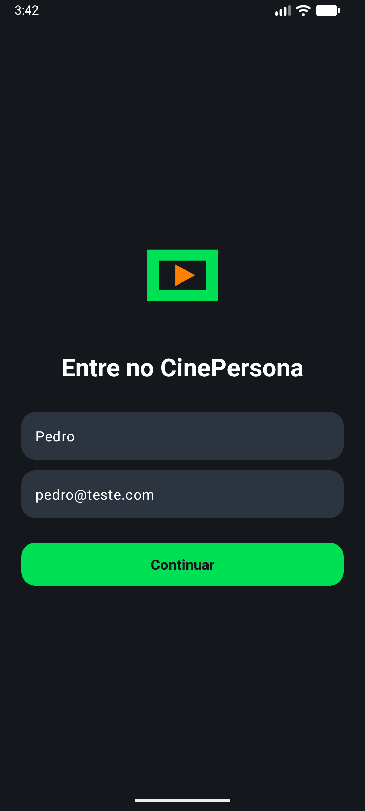
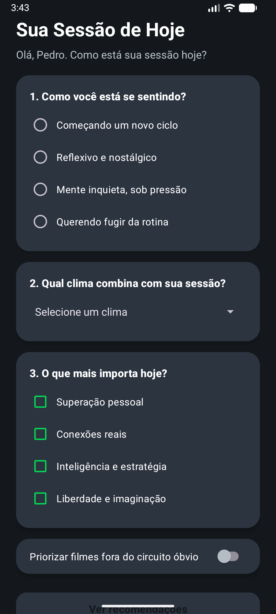
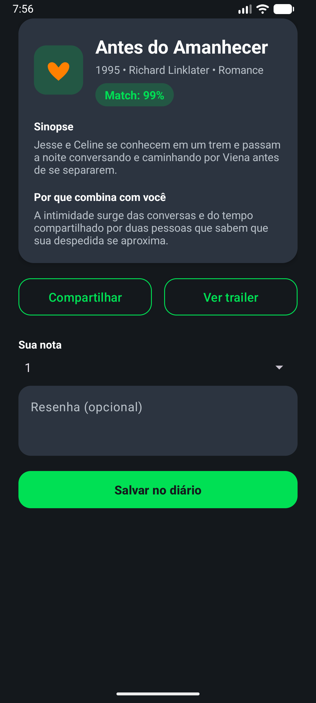

# CinePersona

Aplicativo Android que recomenda filmes a partir de um questionário rápido sobre o momento de vida, o clima desejado para a sessão e as prioridades do dia. As respostas somam pontos em quatro lentes cinematográficas; a lente vencedora define a recomendação e cada filme recebe um percentual de match calculado no backend. O usuário também mantém um diário pessoal de avaliações, com nota de 1 a 5 e resenha opcional. A classificação é uma pontuação ponderada com regras fixas, descritas abaixo.

## Tecnologias

- Android: Java, XML, ViewBinding, Retrofit + Gson, Lifecycle (ViewModel e LiveData), RecyclerView, CardView, Material Components, JUnit
- Backend: Python, FastAPI, Pydantic, SQLAlchemy, SQLite, Uvicorn, pytest

## Arquitetura

```
ap2-app/
  app/                           modulo Android
    src/main/java/com/example/p2/
      ui/                        Activity + ViewModel + Adapter por tela
      data/remote/               ApiService (Retrofit), RetrofitClient, parser de erro da API
      data/repository/           repositorios que expoem LiveData<Resultado<T>>
      domain/model/              modelos compartilhados (Usuario, Filme, Avaliacao, Lente, ...)
      util/                      validacoes e regras puras cobertas por JUnit
    src/test/                    testes JUnit
  backend/
    app/
      routers/                   endpoints FastAPI
      services/                  regras de negocio; pontuacao pura em recomendacao.py
      repositories/              acesso a dados com SQLAlchemy
      seed/                      catalogo inicial de 32 filmes
      models.py  schemas.py  database.py  main.py
    tests/                       pytest (pontuacao e API)
  docs/                          escopo, regras, briefing e screenshots
```

Decisões principais:

- Os modelos de `domain/model` são usados por todas as camadas do Android, sem mappers.
- Todo o cálculo de pontuação fica no backend, em `services/recomendacao.py`, como função pura sem acesso a banco.
- O banco SQLite é gravado apenas através da API.

## Pré-requisitos

- Windows com PowerShell
- Python 3.12 ou mais recente
- Android Studio com SDK 37 e um emulador configurado

## Executando o backend (PowerShell)

```powershell
cd backend
python -m venv .venv
.venv\Scripts\python -m pip install -r requirements.txt
.venv\Scripts\python -m uvicorn app.main:app --port 8000
```

Na primeira subida a API cria e povoa o banco `cinepersona.db`. Deixe essa janela aberta enquanto usa o app.

Testes do backend:

```powershell
.venv\Scripts\python -m pytest -q
```

Documentação interativa (Swagger): http://localhost:8000/docs

## Executando o Android

Emulador:

1. Abra a pasta do projeto no Android Studio e aguarde a sincronização do Gradle.
2. Suba o backend como descrito acima.
3. Clique em Run com um emulador selecionado. O app usa `http://10.0.2.2:8000/` por padrão, que é o endereço do PC visto de dentro do emulador.

Celular físico (cabo USB):

O backend continua o mesmo e não precisa ser desligado: emulador e celular usam a mesma API ao mesmo tempo. O celular chega até ela por um túnel USB criado pelo `adb reverse`.

1. No `local.properties` da raiz do projeto, adicione a linha `api.baseUrl=http://localhost:8000/`, clique em Sync e instale o app pelo Run com o celular selecionado. Basta fazer isso uma vez: o app fica instalado no aparelho.
2. No celular, ative a depuração USB (Opções do desenvolvedor), conecte o cabo e aceite o aviso "Permitir depuração USB?".
3. Em um PowerShell, com o backend ligado:

```powershell
$adb = "$env:LOCALAPPDATA\Android\Sdk\platform-tools\adb.exe"
& $adb devices
& $adb -s NUMERO_DE_SERIE reverse tcp:8000 tcp:8000
& $adb -s NUMERO_DE_SERIE reverse --list
```

- `adb devices` lista os aparelhos. O `NUMERO_DE_SERIE` do celular é a primeira coluna da linha dele (o emulador aparece como `emulator-5554`).
- `-s NUMERO_DE_SERIE` indica com qual aparelho falar. Sem ele, com emulador e celular conectados, o comando falha com `more than one device/emulator` e o túnel não é criado.
- `reverse --list` deve mostrar `tcp:8000 tcp:8000`.

4. Abra o app no celular.

O túnel some quando o cabo é desconectado; nesse caso, repita o comando `reverse`. Para voltar a gerar o app para o emulador, remova a linha do `local.properties` e recompile.

Celular físico (Wi-Fi, sem cabo, com computador e celular no mesmo roteador):

1. No celular: Opções do desenvolvedor → Depuração por Wi-Fi → ativar → "Parear dispositivo com código de pareamento".
2. `& $adb pair IP:PORTA_DE_PAREAMENTO` e digite o código de 6 dígitos mostrado no celular (uma vez por computador).
3. `& $adb connect IP:PORTA` com o endereço da tela principal da Depuração por Wi-Fi (a porta muda a cada vez que a opção é religada).
4. Siga do passo 3 da seção do cabo, usando `IP:PORTA` como número de série.

Problemas comuns:

| Sintoma | Solução |
| --- | --- |
| App no celular: "failed to connect to localhost" | o túnel não existe: repita o `reverse` com `-s` e confira com `reverse --list` |
| `more than one device/emulator` | use `-s NUMERO_DE_SERIE` ou feche o emulador |
| Celular não aparece em `adb devices` | troque o cabo ou a porta USB, aceite o aviso no celular e instale o driver USB do fabricante |
| `unauthorized` em `adb devices` | aceite o aviso "Permitir depuração USB?" no celular |
| `[Errno 10048]` ao ligar o backend | já existe um backend usando a porta 8000: use-o ou feche a janela antiga |

Testes do Android:

```powershell
.\gradlew.bat testDebugUnitTest
```

## Endpoints da API

| Método | Rota | Descrição | Códigos |
| --- | --- | --- | --- |
| POST | /usuarios | Cadastra usuário ou recupera o existente pelo e-mail | 201, 200, 422 |
| GET | /filmes?q= | Lista o catálogo; `q` filtra título e diretor sem diferenciar caixa | 200 |
| POST | /recomendar | Calcula a lente da sessão e a lista de filmes ordenada por match | 200, 404, 422 |
| POST | /avaliacoes | Cria uma avaliação (uma por usuário e filme) | 201, 404, 409, 422 |
| GET | /usuarios/{id}/avaliacoes | Lista as avaliações do usuário com os dados de cada filme | 200, 404 |
| PUT | /avaliacoes/{id} | Atualiza nota e comentário | 200, 404, 422 |
| DELETE | /avaliacoes/{id} | Remove a avaliação | 204, 404 |

## Pontuação

| Resposta | Efeito |
| --- | --- |
| Momento (RadioGroup) | +40 na lente escolhida |
| Clima (Spinner) | +30 na lente escolhida |
| Cada prioridade marcada (CheckBox) | +15 na lente correspondente |
| Total máximo | 85 |

- Lente vencedora: maior total; em empate vale a lente do momento.
- `reconhecimento_percentual = arredondar(100 * total_vencedora / 85)`
- `match_percentual = limitar(75 + arredondar(24 * total_da_lente_do_filme / 85) + bonus, 75, 99)`, com bônus de 5 quando o `is_cult` do filme coincide com o modo lado B escolhido.
- `arredondar(x) = int(x + 0.5)`
- Ordenação da lista: match decrescente e, em empate, título.

## Telas

| Tela | Screenshot |
| --- | --- |
| Login |  |
| Questionário |  |
| Recomendações |  |
| Detalhes do filme |  |
| Meu diário |  |
